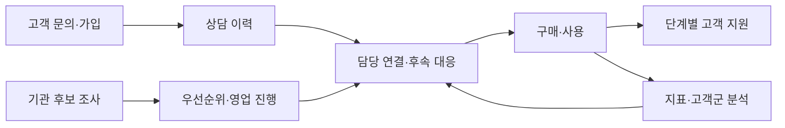

# 프로젝트 지도

하나의 거대한 자동화가 아니라, 고객이 들어온 순간부터 구매·사용·후속 관리까지 생기는 운영 문제를 다룬 작업들입니다. 아래 ‘원본에서 확인’은 해당 파일의 코드·설명에서 확인했다는 의미이며, 운영 환경에서 현재 실행 중임을 실시간 검증했다는 의미는 아닙니다.

| 영역 | 원본에서 확인한 작업 | 공개 형태 |
|---|---|---|
| 고객 맥락 | 여러 상담 탭 통합, 이전 기록 보존, 노트 이관 | 별도 Ledger 저장소·실행 예제 |
| 세일즈 실행 | 일일 콜 분배, 담당 배정, 중복 요청·거절 후 재배정 | 별도 Routing 저장소·실행 예제 |
| 의사결정 | 데이터 상태 점검, 주간 비교, 코호트·환불 후 상태·사용 분석 | 별도 Dashboard 저장소·합성 데이터 화면 |
| 기관 영업 | 공공 데이터 후보 선정, 영업 상태 기록, 시트와 화면 동기화 | 사례 문서. 실제 후보 목록·가중치는 제외 |
| 고객 도입·활용 | 단계별 리포트 템플릿, 근거와 다음 행동을 담은 문서 | 사례 문서. 실존 고객 결과물·교재·브랜드 자산은 제외 |

## 어디까지 주장할 수 있는가
- 코드와 변경 기록으로 특정 문제를 다룬 방식은 설명할 수 있습니다.
- 코드만으로 실제 사용 빈도, 절감 시간, 개별 전환율 상승을 확정할 수는 없습니다.
- 팀 성과와 개별 도구의 인과 효과는 구분해야 합니다.
- 기관 후보 수를 고객 수나 계약 수로 표현하지 않습니다.
- AI를 활용한 구현을 전부 직접 수작업으로 작성한 개발 경력으로 표현하지 않습니다.
