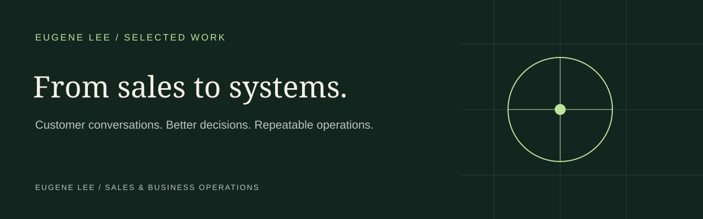

# 고객을 만나고, 팀이 일할 방법을 만듭니다.

고가 상품을 직접 판매하면서 상담, 후속 대응, 팀 운영과 업무 개선을 함께 맡아왔습니다. 고객이 왜 망설이는지, 팀이 어디서 같은 일을 반복하는지, 숫자가 무엇을 설명하지 못하는지에 관심이 있습니다.

[개인 포트폴리오](https://leeyjn.github.io/) · [프로젝트 전체 지도](PROJECTS.md) · [고민과 선택의 기록](DECISIONS.md)

**[대시보드 데모 열기](https://leeyjn.github.io/revenue-decision-dashboard/)** — 지표와 분석 단계를 직접 눌러볼 수 있습니다.

## Selected projects

| 프로젝트 | 출발한 질문 | 살펴볼 내용 |
|---|---|---|
| **[Revenue Decision Dashboard](https://github.com/leeyjn/revenue-decision-dashboard)** | 숫자를 본 다음, 무엇을 결정할 것인가? | 데이터 상태 → 지표 정의 → 고객군 분해 → 가설 → 후속 행동. 합성 데이터 인터랙티브 데모 |
| **[Customer History Ledger](https://github.com/leeyjn/customer-history-ledger)** | 작업 목록을 정리해도 고객 맥락을 남길 수 있을까? | 출처별 이력 보존, 중복 집계 방지, 예정과 실제 접촉 구분 |
| **[Customer Routing Engine](https://github.com/leeyjn/customer-routing-engine)** | 공평한 분배와 좋은 고객 응대가 충돌하면? | 최근 상담 맥락, 담당자 지정, 업무량, 중복 요청과 거절 처리 |
| **[Account Prioritization & Shared Pipeline](cases/account-prioritization.md)** | 어디부터 영업하고, 진행 상황을 어떻게 함께 볼까? | 공공 데이터 기반 후보 선정, 영업 기록 동기화, 점수의 한계 |
| **[Customer Adoption Playbooks](cases/customer-adoption.md)** | 구매 전후의 서로 다른 질문을 어떻게 지원할까? | 고객 단계별 정보 설계, 근거 있는 개인화, 다음 행동을 돕는 문서 |

## What connects the work

**직접 판매한 경험**은 고객의 망설임을 구체적인 질문으로 만들었습니다. **팀을 운영한 경험**은 그 질문을 한 사람의 기억에만 남겨두지 않도록 했습니다. **분석과 자동화**는 반복되는 문제를 확인하고 팀이 함께 쓸 수 있는 방식으로 바꾸는 도구였습니다.

그래서 프로젝트마다 결과뿐 아니라 기준, 예외, 아직 모르는 부분을 함께 적었습니다. 예쁜 화면이나 자동화 개수보다 **왜 그 방식을 택했는지**가 보이도록 구성했습니다.

## Working with technology

Python · Google Apps Script · Sheets · BigQuery · CRM workflows · Slack · AI-assisted implementation

실제 업무 산출물에서 문제와 설계 선택을 검토해 공개용 자료로 재구성했습니다. 공개 코드·시각화·테스트는 AI 도구의 도움을 받아 새로 작성한 예제입니다. 회사 운영 코드, 고객 데이터, 내부 문서 원문은 공개하지 않습니다. 데모 수치는 모두 가상이며 실제 성과가 아닙니다.
