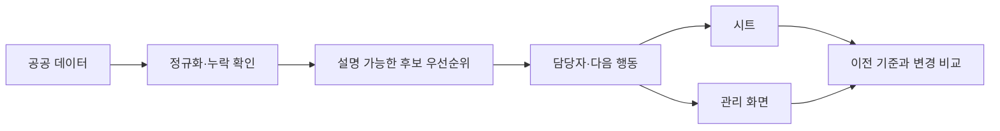

# Account Prioritization & Shared Pipeline
## 후보를 많이 모으는 것보다, 왜 먼저 연락할지 설명하기

기관 영업에서는 영업 가능한 후보와 이미 고객인 기관을 구분해야 합니다. 원본에는 공공 데이터를 바탕으로 지역 환경·기관 특성·접근성 등을 정리하고 우선순위를 매기는 도구가 있습니다.

### 확인된 고민
- 무작정 많은 후보를 수집하는 대신, 왜 이 기관부터 검토할지 설명할 기준을 만들었습니다.
- 공개 API의 페이지 제한과 지역명 변화가 누락·오집계를 만들 수 있어 보정 로직을 두었습니다.
- 사람들이 익숙한 시트와 별도 관리 화면을 함께 사용하기 때문에 양쪽 기록이 충돌할 수 있었습니다.
- 이전 동기화 기준값·시트 현재값·화면 현재값을 비교하고, 양쪽이 바뀐 경우의 우선순위를 정했습니다.

### 선택과 한계
점수는 계약 가능성을 검증한 예측 모델이 아니라 조사·접촉 순서를 돕는 휴리스틱입니다. 데이터 접근성에 따른 편향이 있고, 점수가 낮아도 중요한 기관이 있을 수 있습니다. 양방향 충돌 시 한쪽 우선은 단순하지만 수정 의도를 잃을 수 있어, 충돌 검토 화면은 향후 개선 후보입니다.

### 공개 범위
실제 대상 목록, 거래 관계, 담당자, 기관별 점수, 가중치와 내부 동기화 주소는 공개하지 않습니다. 이 사례는 영업 준비와 운영 도구의 구축 경험이며, 후보를 실제 계약·수주로 표현하지 않습니다.
